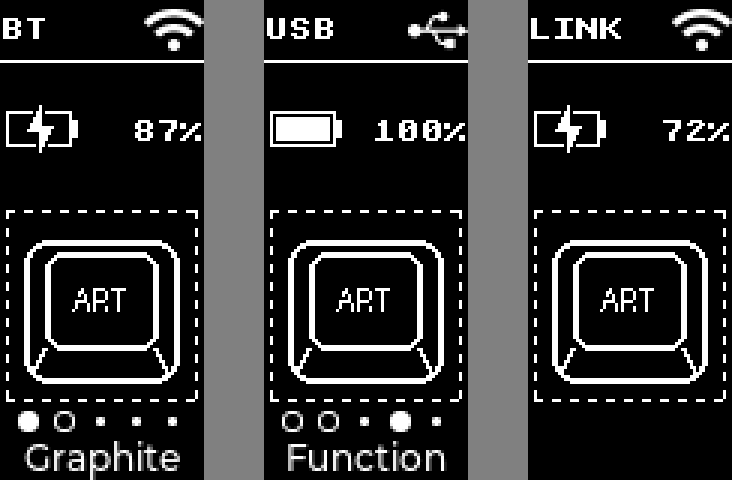

# nice-view-custom

A nice!view status screen for ZMK **main / v0.4 (Zephyr 4.1, LVGL 9)**, for split keyboards.



*Left to right: central charging on BT 1, central on profile 4 / Function layer, peripheral. Rendered from the module's drawing code.*

| Section | Central (left) | Peripheral (right) |
|---|---|---|
| Top | Output (`USB` / `BT` + state icon), own battery | Link status, own battery |
| Middle | 68×68 art image | 68×68 art image |
| Bottom | BLE profile dots, active layer name | Optional label |

Profile dots: filled = active, ring = bonded, small dot = empty profile.
Battery: each half shows its own. The bar shows the level; while charging over USB it is replaced by a bolt (percentage still shown).

## Usage

`config/west.yml`:

```yaml
manifest:
  remotes:
    - name: appleboblin
      url-base: https://github.com/appleboblin
  projects:
    - name: nice-view-custom
      remote: appleboblin
      revision: main
```

`build.yaml` — use `nice_view_custom` instead of `nice_view`:

```yaml
include:
  - board: nice_nano//zmk
    shield: corne_left nice_view_adapter nice_view_custom
  - board: nice_nano//zmk
    shield: corne_right nice_view_adapter nice_view_custom
```

Requires ZMK `main` (or v0.4 once released). It will not build on v0.3 (LVGL 8).

## Options (`<keyboard>.conf`)

| Option | Default | |
|---|---|---|
| `CONFIG_NICE_VIEW_CUSTOM_ART` | `""` | Path to your art `.c` file, absolute or relative to the `config/` folder. Empty = built-in placeholder. |
| `CONFIG_NICE_VIEW_CUSTOM_INVERTED` | `y` | White on black. Set `n` for black on white |
| `CONFIG_NICE_VIEW_CUSTOM_PERIPHERAL_LABEL` | `""` | Text in the peripheral's bottom band, e.g. `"Corne"` |

Layer names come from each layer's `display-name` (the name in `ZMK_LAYER(name, ...)` with zmk-helpers). Layers without one show `Layer N`.

## Custom art

The middle slot is 68×68, 1-bit. Draw it upright (portrait); rotation is handled in firmware.

```sh
pip install pillow
python3 tools/png2lvgl.py my_art.png -o config/art.c --preview preview.png
```

then in `config/corne.conf`:

```
CONFIG_NICE_VIEW_CUSTOM_ART="art.c"
```

Converter flags: `--dither` (photos), `--threshold N` (0–255, default 128), `--invert` (swap ink/background in the source), `--fit contain|cover|none`. Images larger than 68×68 are shrunk; smaller ones stay pixel-exact and are centered. Dark pixels in your source image become ink (drawn white on the default black screen); light and transparent pixels become background. Pixel art drawn at exactly 68×68 looks best on this panel.

The art file is compiled into both halves. Only use artwork you have the rights to.

## Credits

Drawing helpers and display setup adapted from ZMK's built-in nice!view shield (MIT). Layout idea inspired by [infely/nice-view-battery](https://github.com/infely/nice-view-battery).
